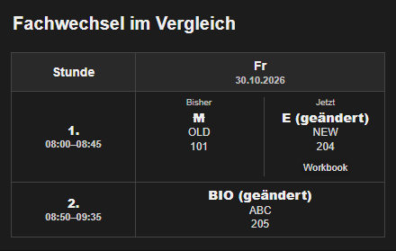

# Card v3.11.0-beta.1 - Vorabversion

**Vorabversion nur für freiwillige Tests. Bitte vorher ein HA-Backup erstellen.**
Testkombination: Card **v3.11.0-beta.1**, Suite **v0.4.0b1** und
Schulmanager Online **v0.13.0b4**. Noch kein reguläres Update.

## Fachwechsel und Kursfilter

*Beispiel mit erfundenen Stundenplandaten.*

Bei einem echten Fachwechsel stehen ursprünglicher und neuer Unterricht jetzt
nebeneinander: **Bisher** und **Jetzt**. Reine Raum- oder Lehrerwechsel bleiben
kompakt. Mehrere Räume, Lehrkräfte und zusätzliche Hinweise bleiben sichtbar.
Die ursprüngliche Stunde dient nur zum Vergleich und zählt nicht als zusätzlicher Unterricht.

Unter **Inhalte filtern** zeigt die Karte, welche Kurse bereits durch die Suite
ausgeblendet werden. Zusätzliche Filter nur für diese Karte stehen getrennt darunter.
Diese beiden Suite-Funktionen benötigen **Suite v0.4.0b1** mit der neuen
Schulmanager-Anbindung. Diese ist optional und wurde mit **Schulmanager Online
v0.13.0b4** getestet; die Schulmanager-Version ist noch eine Vorabversion.
Bestehende Quellen werden nicht automatisch umgestellt.

## Ferien und Kalender

- Unter **Ferien** einen vorhandenen Kalender auswählen: Erkannte ganztägige
  Ferieneinträge erscheinen mit Zeitraum über der Tabelle und an den passenden Tagen.
  Unterricht wird dabei nicht ausgeblendet oder automatisch übersprungen.
- Kalenderhinweise unterstützen auch benannte Zeilen, etwa `Pasta [Essen]`.
  Die Zeile muss bereits im Stundenplan existieren.

Vorhandene Einstellungen bleiben erhalten. Nach dem HACS-Update das Dashboard
vollständig neu laden. Getrennte Testkarten und Testressourcen werden dadurch
nicht automatisch auf die normale HACS-Karte umgestellt.

[Ferien einrichten](https://github.com/fabel-smith/stundenplan-card/blob/v3.11.0-beta.1/docs/HOLIDAYS.md) ·
[Kalenderhinweise](https://github.com/fabel-smith/stundenplan-card/blob/v3.11.0-beta.1/docs/CALENDAR_DIRECT_TEST.md) ·
[Kurze Testanleitung und Rückweg](https://github.com/fabel-smith/stundenplan-card/blob/v3.11.0-beta.1/docs/PRERELEASE_TEST.md) ·
[Passende Suite v0.4.0b1](https://github.com/fabel-smith/stundenplan-suite/releases/tag/v0.4.0b1)
