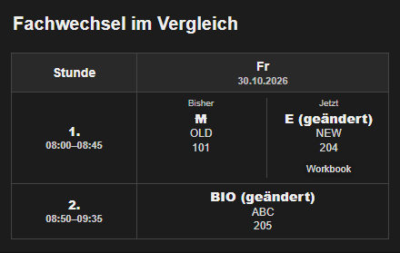

# Card v3.11.0 - Fachnamen, Ferien und klare Wochenansichten

- **Fachnamen & Abweichungen:** Kürzel dauerhaft umbenennen, etwa BSS zu Sport, oder Fächer an bestimmten Tagen ersetzen. Beides ist in einem Akkordeon zusammengefasst; dauerhafte Namen benötigen keine Termine.
- **Ferienkalender:** Ferien aus einem ausgewählten Kalender im Plan kennzeichnen. Unterricht wird dadurch nicht pauschal ausgeblendet.
- **Schulmanager-Kurse:** Bereits von der Suite ausgeblendete Kurse sind im Editor nachvollziehbar. Zusätzliche Kartenfilter gelten nur für diese Karte.
- **Klare Änderungen:** Tatsächliche Fachwechsel erscheinen als Bisher/Jetzt. Lehrkräfte und Räume bleiben dem jeweiligen Parallelkurs zugeordnet.
- **Wochenwechsel:** Wahlweise ab Samstag oder Sonntag zur kommenden Woche wechseln. Datum und Unterricht passen auch in der Rolling-Ansicht zusammen. Fehlende Daten werden von einer geladenen Woche ohne Unterricht unterschieden.
- **Ruhigere Kalenderanzeige:** Der Hinweis zu übersprungenen Kalenderterminen erscheint nur im Editor. Echte Kalenderfehler bleiben auf der Karte sichtbar.
- Neue Projekticons.

## Aktualisieren

Für die neue Schulmanager-Anbindung zuerst [Schulmanager Online v0.13.0](https://github.com/MrIcemanLE/Schulmanager-homeassistant/releases/tag/v0.13.0) und [Suite v0.4.0](https://github.com/fabel-smith/stundenplan-suite/releases/tag/v0.4.0) installieren, dann Home Assistant neu starten. Die Karte über HACS aktualisieren und das Dashboard vollständig neu laden. Vorher ein Backup anlegen.

Manuelle Pläne und JSON bleiben unabhängig nutzbar. Bestehende Quellen und Einstellungen werden nicht automatisch umgestellt. Zusätzliche Datenwochen sind nur verfügbar, soweit die Quelle sie bereits geladen hat; die manuelle Suite-Wochenwahl bleibt bei -1 bis +1.

[Schulmanager einrichten](https://github.com/fabel-smith/stundenplan-suite/blob/v0.4.0/SCHULMANAGER_SCHEDULE.md) · [Fachnamen und Termine](https://github.com/fabel-smith/stundenplan-card/blob/v3.11.0/docs/DATED_ENTRIES.md) · [Ferienkalender](https://github.com/fabel-smith/stundenplan-card/blob/v3.11.0/docs/HOLIDAYS.md)

Danke an @MrIcemanLE und @heilbreitenbach für die gemeinsame Abstimmung und die Praxistests!
